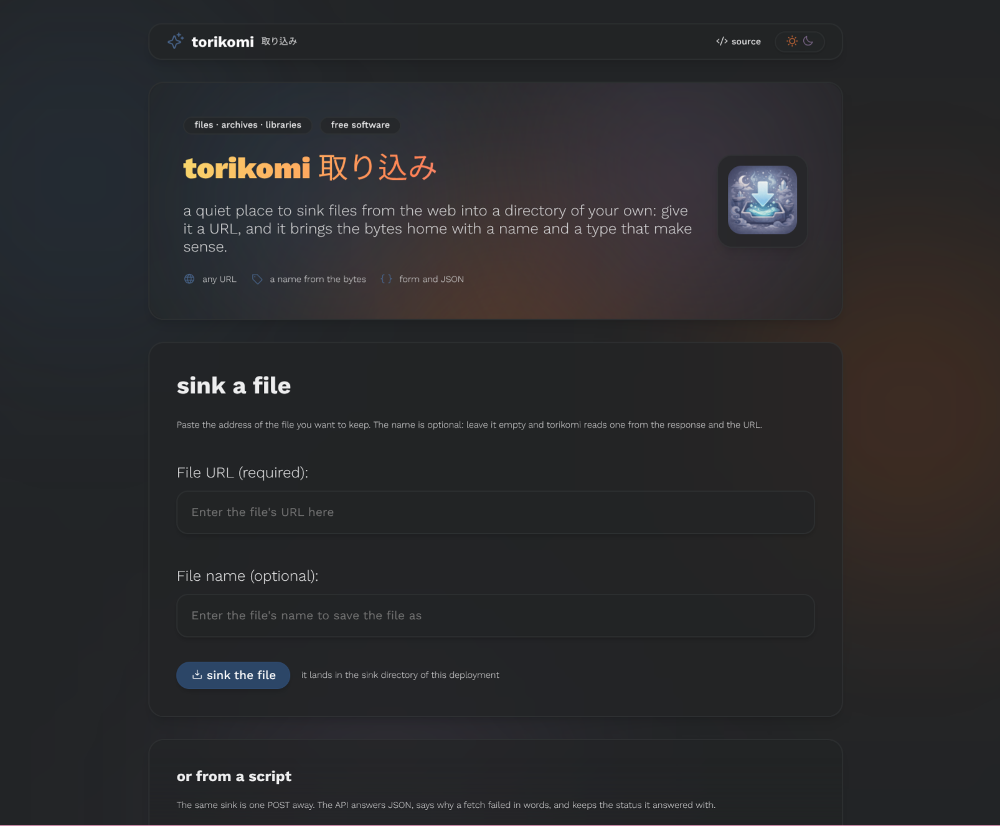

#+title: torikomi
#+author: Josep Bigorra
#+email: jjbigorra@gmail.com
#+language: en
#+options: toc:nil

[[https://jointhefreeworld.org/ggg/dist/scheme-guile.svg]] [[https://jointhefreeworld.org/ggg/dist/gnu-guix.svg]]
[[https://jointhefreeworld.org/ggg/dist/gnu-make.svg]]
[[https://jointhefreeworld.org/ggg/dist/license-mit.svg]]
[[https://jointhefreeworld.org/ggg/dist/gnu-artanis.svg]]

#+attr_html: :width 160 :alt torikomi logo

- 📖 *API reference:* [[https://jointhefreeworld.org/api-docs/torikomi/index.html][Torikomi API reference]]

Torikomi (取り込み): Meaning "ingest," "capture," or "import."  in Japanese.

torikomi is a minimalist web service built with GNU Artanis and Guile Scheme for archiving and building collections and libraries of files.

It provides a simple interface—both via a web form and a REST API—to *"sink" (download) files from a remote URL directly into a local directory* on your server.

You can simply give the filename that you want, or use the automated naming: torikomi reads response headers and bytes, and will extract file name and file type from URLs you want and download those files and name them properly.

Since torikomi is built to create multimedia archives, when conflicting between files (more than 1 of same name) torikomi saves a copy with a different name.

This is torikomi version 0.3.7.  ~maak version~ prints it, and ~maak sync-version~ keeps the copies in this manual in step with ~lib/torikomi/version.scm~.

- Supports traditional HTML forms and modern JSON REST endpoints.
- A frosted-glass interface with a light and a dark theme: the theme follows the system by default, is remembered once chosen, and is applied before the first paint.
- Minimalist Core: Built on the powerful Guile Scheme language.
- Built using the Lisp powered UI combo ([[https://github.com/jjba23/hygguile][Hygguile]] and [[https://github.com/jjba23/olive-css][Olive CSS]])
- Read the source (and send PRs, issues and patches): [[https://github.com/jjba23/torikomi][github.com/jjba23/torikomi]]
- TODO: Let user choose file conflict strategy?
- TODO: Let user choose auto-conversion to AVIF or WEBP or others
- TODO: Let user create auto tar-ball or zip

If you like my work, please support me by [[https://bmc.link/jjbigorra][buying me a cup of coffee ☕]] so I can continue with a lot of motivation.

** The endpoints

- ~GET /~ is the homepage.
- ~POST /sink-file~ is the form endpoint: it takes ~file-url~ and an optional ~file-name~ as a URL-encoded form, and answers with the same page, the sunk file's address and, when the fetch failed, an alert saying why.
- ~POST /api/v1/sink-file~ is the REST API endpoint: it takes the same fields as a JSON object (or as a URL-encoded form), and answers with JSON:

#+begin_src json
{"ok": true, "file-name": "pic.jpg", "url": "https://example.org/files/pic.jpg", "new-url": "https://example.org/files/pic.jpg", "bytes": 24310, "file-url": "https://example.org/pic.jpg"}
#+end_src

~url~ and ~new-url~ are the same address: the second is the name the first
version of the API used, kept so a client written against it keeps working.

A failure answers with the status that says what happened and a JSON body that says it in words:

#+begin_src json
{"ok": false, "error": "https://example.org/missing.jpg answered with HTTP 404.", "upstream-status": 404}
#+end_src

- ~GET /api/v1/version~ answers with the name, version, licence and homepage of the program.
- ~GET /api/v1/health~ answers ~{"status":"ok"}~ and the version; it is for a load balancer or a smoke test that must not fetch anything.

It might happen sometimes that some pages return 401 or 404 HTTP status codes and thus the download will fail.
It is also possible that DNS resolution was not successful for a URL from within the server, check with your server administrator for more settings.

I mainly use torikomi to create image or file archives, for example, for [[https://wikimusic.jointhefreeworld.org][wikimusic]], see my library at [[https://visus-aeternus.jointhefreeworld.org]]

** What a sink does

#+attr_html: :width 720 :alt A URL validated, downloaded, named, written and answered as a sink-result

A request is a URL and an optional name; everything after that is what
~lib/torikomi/torikomi.scm~ describes.  The URL is checked against the schemes
the deployment allows, the body is fetched, a name is chosen from the response
header and the address itself, and the bytes are written into the sink
directory.  The answer is a ~sink-result~ either way: a success carrying the
name, the path, the public URL and the size, or a failure carrying a status and
a sentence a reader can act on.  ~POST /sink-file~ and
~POST /api/v1/sink-file~ are two ways to ask the same procedure.

The source of the diagram is
[[file:resources/diagrams/sink-file.mmd][resources/diagrams/sink-file.mmd]]; ~maak diagrams~
renders every source under ~resources/diagrams~ to the SVG beside it.

** What it does when the network is not perfect

A sink is a request made on somebody else's behalf to a server nobody here
controls, so most of the code is about the cases where that server is having a
bad day:

- *Only http and https are fetched.*  A ~file://~ URL would read the server's
  own disk; libcurl is restricted to the two protocols for the request and for
  every redirect it follows.
- *Certificates are verified* unless a deployment explicitly says otherwise
  (~TORIKOMI_CURL_VERIFY_TLS=0~).  A Guix deployment gets its certificate
  bundle from ~nss-certs~.
- *The last response decides.*  A redirect chain's status, type and name come
  from the response that produced the body, not from the first hop.
- *Names are made safe.*  The last path component is taken whatever the caller
  sent, unsafe characters become dashes, ~.~ and ~..~ are refused, and a very
  long name is shortened but keeps its extension.
- *The name comes from the best source there is:* the reader's form, then the
  server's ~Content-Disposition~ (including RFC 5987 ~filename*~), then the
  URL's own last segment.
- *The extension follows the bytes:* the media type is looked up in a table,
  then its subtype, then the header's name, then the URL; ~bin~ is the answer of
  last resort.
- *Nothing is overwritten.*  A name is reserved with ~O_EXCL~, and a collision
  is retried with a UUID suffix; the bytes are written to a temporary file and
  renamed into place, so a reader never sees half a file.
- *Transient failures are retried* (connection failures, 408, 425, 429, 500,
  502, 503, 504) with a doubling delay; a 404 or a refused certificate is not.
- *Downloads are bounded* by ~TORIKOMI_MAX_FILE_BYTES~ (256 MiB by default);
  libcurl aborts a body whose length is announced, and the body is measured
  again when it arrives.
- *Every failure is an ordinary answer:* 400 for a URL that is not one, 413 for
  a body over the limit, 502 (with the upstream status) for a remote that
  refused, and 500 only for a bug.

** Configuration

A deployment is configured through its environment.  Every setting has a
default that a fresh clone runs with, so no file is required to start torikomi.

| Variable                             | Default                     | Meaning                                                       |
|--------------------------------------+-----------------------------+---------------------------------------------------------------|
| ~TORIKOMI_SINK_DIRECTORY~              | ~pub/tmp~                    | Where sunk files are written (created on demand).             |
| ~TORIKOMI_BASE_URL~                    | ~http://localhost:50027/tmp~ | The address public URLs start with.                           |
| ~TORIKOMI_CURL_TIMEOUT_SECONDS~        | ~60~                         | Whole-transfer timeout.                                        |
| ~TORIKOMI_CURL_CONNECT_TIMEOUT_SECONDS~ | ~15~                        | Connection timeout.                                            |
| ~TORIKOMI_CURL_MAX_REDIRECTS~          | ~10~                        | Redirects followed.                                            |
| ~TORIKOMI_CURL_RETRIES~                | ~2~                         | Retries after a transient failure; ~0~ turns retrying off.     |
| ~TORIKOMI_CURL_RETRY_DELAY_SECONDS~    | ~1~                         | First retry delay; it doubles each time.                       |
| ~TORIKOMI_CURL_VERIFY_TLS~             | verify                      | Set to ~0~ only for a host with a self-signed certificate.     |
| ~TORIKOMI_CA_BUNDLE~                   | ~$SSL_CERT_FILE~            | Certificate bundle, when the deployment keeps its own.         |
| ~TORIKOMI_MAX_FILE_BYTES~              | ~256M~                      | Largest body kept; ~K~, ~M~, ~G~ and ~T~ suffixes are understood. |
| ~TORIKOMI_FILENAME_MAX_LENGTH~         | ~120~                       | Longest file name written.                                     |
| ~TORIKOMI_USER_AGENT~                  | ~torikomi/<version>~        | The agent a remote sees.                                       |
| ~TORIKOMI_URL_SCHEMES~                 | ~http,https~                | Schemes accepted; only those two are ever enabled.             |

A value that is not what it claims to be -- a timeout of ~soon~, a negative
retry count, a size of ~lots~ -- is ignored and the project's value is kept.
A setting that means nothing cannot be allowed to mean anything.

Older deployments kept these in an ~env.scm~ file at the root of the checkout:

#+begin_src scheme
(define-module (torikomi env))

(define-public torikomi-sink-file-directory "pub/tmp")

(define-public torikomi-sink-file-base-url "http://localhost:50027/tmp")

(define-public torikomi-curl-timeout-seconds 60)
#+end_src

That file is still read when it is there, so an existing installation only has
to be restarted rather than rewritten; the environment variable always wins.
A fresh checkout needs no file at all.

** Development

The project uses [[https://github.com/jjba23/maak][maak]]; the tasks worth knowing:

| Task                | What it does                                                       |
|---------------------+--------------------------------------------------------------------|
| ~maak dev~            | Watch the tree and restart the server on a change.                  |
| ~maak server~         | Start the development server on port 50027.                         |
| ~maak production-server~ | Start it with ~conf/production.conf~.                          |
| ~maak test~           | Run the suite under ~test/veritas/unit~.                            |
| ~maak docs~           | Write the API reference to ~doc/api-dist/index.html~ with dokgen.    |
| ~maak diagrams~       | Render every mermaid source under ~resources/diagrams~.             |
| ~maak sink-dir~       | Create the sink directory the configuration names.                  |
| ~maak version~        | Print the version, licence and homepage.                            |
| ~maak sync-version~   | Write the version into the files that cannot read it, commit and tag. |
| ~maak fmt~            | Format the Scheme sources with ~guix style~.                        |
| ~maak olive-css~      | Refresh the Olive CSS from its source.                              |
| ~maak repl~           | A development REPL (ares/nREPL).                                    |

The manifest pins the Scheme libraries at the versions the project is known to
run against, and names the command-line tools the tasks drive, so ~guix shell -m
manifest.scm~ is the whole development environment.

** Tests

The suite is [[https://github.com/jjba23/veritas][Veritas]] and lives under
~test/veritas/unit~; ~maak test~ runs it, with a locale named rather than
inherited so that the pages read the same everywhere.

The specs read the code where the decisions are (a status line, a media type, a
name) and sink a real file end to end: a small HTTP server on localhost serves
the redirects, the 404s, the flaky gateway and the oversized body, and a
temporary directory receives the bytes.  The page is rendered and read as the
markup a browser is handed.

** Logging

Every fetch is logged to the error port -- the one a service manager captures --
with the URL, what was written and, when it failed, why.  Nothing is written to
standard output, which belongs to the server's own chatter.

--------

* Licensing

torikomi and all of its source code are free software, licensed under the [[https://opensource.org/license/mit][MIT License]].

The documentation and examples, including this document, which are provided with torikomi, are all licensed under the Creative Commons Attribution 4.0 International License.

https://creativecommons.org/licenses/by/4.0/

-------

* Code of conduct

This project adheres to the jointhefreeworld code of conduct. Find it here:

https://jointhefreeworld.org/blog/articles/personal/jointhefreeworld-code-of-conduct/index.html

In summary, we foster an inclusive, respectful, and cooperative environment for all contributors and users of this free software project. Inspired by the ideals of the GNU Project, we strive to uphold freedom, equality, and community as guiding principles. We believe that collaboration in a community of mutual respect is essential to creating excellent free software.

-------

** On fonts

The interface is set in three libre families, all under the SIL Open Font
License 1.1, and named by the Olive CSS build this project ships: *Work Sans*
for prose, *Source Serif 4* for long-form reading and *JuliaMono* for code.

They are not bundled here: the stylesheet names them, and a page that serves
their woff2 files renders in them, while a page that does not falls back to the
system's own sans, serif and monospace faces. The files are published at
[[https://fonts.google.com/][Google Fonts]] (Work Sans, Source Serif 4) and at
[[https://juliamono.netlify.app/][juliamono.netlify.app]] (JuliaMono, which is
not in the Google Fonts catalogue); self-host them beside your own stylesheet
if you want the page set in them without asking a third party for the files.

-------
